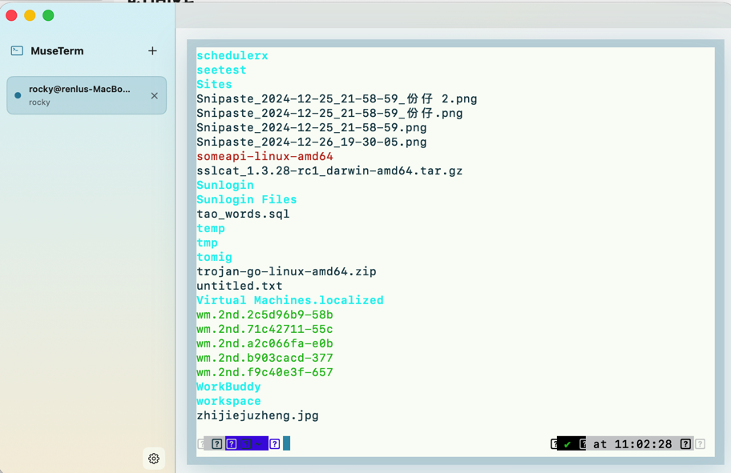

# MuseTerm

MuseTerm 是一个轻快的 macOS 多标签终端应用，使用 SwiftUI 构建外壳界面，并通过 SwiftTerm 提供本地 shell 终端能力。



## 核心能力

- 多标签终端，支持快捷键新建、切换和关闭标签。
- 项目分组与水平/垂直分屏，支持独立焦点、比例调整、移动及恢复。
- 独立后台持有新终端，退出界面后原进程继续；WillDeep 原生状态、待处理与 CLI/MCP 等待共享同一会话身份。
- 原生内联图片，支持 Kitty Graphics Protocol、iTerm2 Inline Images 与 Sixel，并可配置每标签图片缓存预算。
- SSH 主机管理，支持多跳、独立密钥和连接后启动命令。
- 会话隧道：手工进入二跳、三跳服务器后，把本机 `127.0.0.1` 端口临时转发到深层内网 TCP 服务；优先自动上传匹配 Linux/macOS amd64/arm64 的 Go 静态助手，Python 3 仅作为旧环境回退，并用蒙版和右侧检查器明确提示终端已被占用；CLI/MCP 可启动、停止和查询会话隧道。
- 终端录制捷径，可录制输入并在当前标签回放。
- rz/sz 文件传输，支持上传、下载、远端依赖检查和进度展示。
- 主题、字体、光标、ANSI 配色，以及相互独立的窗口/终端透明度和毛玻璃设置。
- CLI/MCP 工具桥默认只读；写入需在设置中开启，并使用逐客户端 Keychain 授权。

## 运行

1. 打开 `museterm.xcodeproj`
2. 选择 `museterm` scheme
3. 在 Xcode 中运行

## 常见操作

如果关闭运行中标签时勾选过“以后不再询问”，本机偏好会保留这个选择。要恢复关闭确认弹窗，可以运行：

```bash
defaults delete im.some.museterm terminal.skipRunningTabCloseConfirmation
```

## 版本

当前版本：`v1.251.0-rc31`

从旧版升级及现有会话保留方式见 [升级说明](docs/UPGRADING_QTERM_RUNTIME.md)。

会话事件、Agent 状态、待处理聚合与 CLI/MCP 条件等待见 [使用说明](docs/AGENT_STATE_EVENTS.md)。
