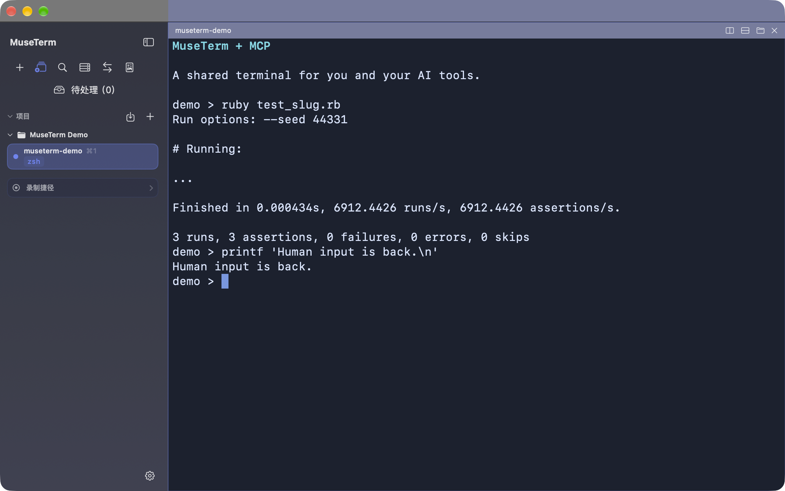
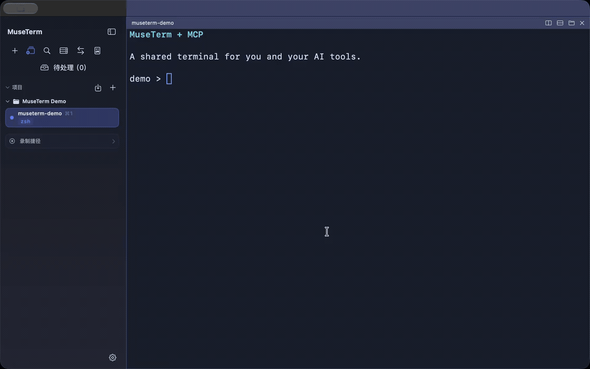
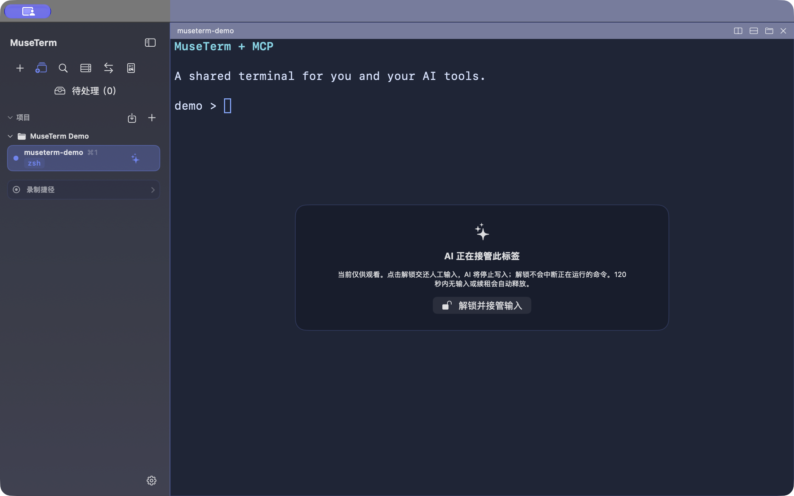

# MuseTerm

MuseTerm 是一个轻快的 macOS 多标签终端应用，使用 SwiftUI 构建外壳界面，并通过 SwiftTerm 提供本地 shell 终端能力。



## 与 AI 共用一个终端

通过 MCP 连接 Claude Code 等 AI 工具，读取终端内容、接管指定标签并执行命令。执行过程在 MuseTerm 中可见，你也可以随时点击“解锁并接管输入”，收回键盘控制权。



演示顺序：**接管指定终端 → 运行 Ruby 示例测试 → 人工解锁 → 继续键盘输入**。GIF 由真实应用窗口录屏转换而来，使用脚本驱动产品自带的 MCP 工具桥；未调用模型，也未模拟 Claude Code 的回答。[观看 MP4](docs/media/mcp-ai-takeover.mp4) · [素材说明](docs/media/README.md)

<details>
<summary>查看 AI 接管时的界面</summary>



接管期间，目标终端显示输入锁，避免人工按键与 AI 输入混在一起。解锁只收回输入权，不会终止已经运行的命令；AI 也可以主动释放控制权。

</details>

### 接入 Claude Code

1. 打开 MuseTerm 的“设置 → MCP 与命令行”，点击“安装 CLI”。
2. 在终端注册 MCP 服务：

   ```bash
   claude mcp add --transport stdio --scope user museterm -- "$HOME/.local/bin/museterm" mcp
   ```

3. 在 Claude Code 中执行 `/mcp`，确认 `museterm` 已连接。`--scope user` 让当前用户的所有项目都能使用这个连接。
4. 如需 AI 输入命令，在 MuseTerm 同一设置页开启“允许已配对客户端写入”，再点击“配对 museterm CLI”。

可以给 Claude Code 这样的任务：

> 使用 MuseTerm MCP，先查看标签列表并读取演示终端，确认目标后接管它；运行 `pwd` 和 `git status --short`，读取结果，最后释放控制权。不要操作其他标签。

MCP 的基本调用顺序是 `help` → `list_tabs` → `read_screen` → `takeover_tab` → `send_text` / `send_key` → `release_tab`。接管及后续操作须使用同一个明确的标签 UUID，并保持在同一个 MCP 连接中。长任务可调用 `renew_tab_control` 续租；120 秒没有成功输入或续租会自动释放。

需要操作支持鼠标的 TUI 时，可在接管后调用 `send_mouse(tab, column, row, button)`；`column` 和 `row` 是从 1 开始的终端单元格坐标，`button` 可选 `left`、`middle` 或 `right`，默认为 `left`。目标 TUI 必须已启用鼠标跟踪，并且 MuseTerm“设置 → 行为 → 转发鼠标报告”已开启。X10 编码最多表示第 223 列/行，超出时工具会明确报错；SGR-pixel 模式按目标单元格中心发送像素坐标。此工具发送终端鼠标报告，不移动或点击 macOS 系统指针。

其他支持 stdio MCP 的客户端也可以将 `$HOME/.local/bin/museterm` 配置为命令、`mcp` 配置为参数。Agent 状态与待处理事项的说明见 [会话事件与 Agent 集成](docs/AGENT_STATE_EVENTS.md)。

## 核心能力

- 多标签终端，支持快捷键新建、切换和关闭标签。
- 项目分组与水平/垂直分屏，支持独立焦点、比例调整、移动及恢复；侧栏宽度可在 220–420pt 间拖动保存，项目操作按钮完整显示并留出右侧空白。
- 独立后台持有新终端，退出界面后原进程继续；WillDeep 原生状态、待处理与 CLI/MCP 等待共享同一会话身份。
- 原生内联图片，支持 Kitty Graphics Protocol、iTerm2 Inline Images 与 Sixel，并可配置每标签图片缓存预算。
- 图片与 Markdown 侧栏预览，支持文件刷新、独立窗口、缩放和源码切换，并提供 `museterm preview` / MCP 入口。[使用说明](docs/MEDIA_PREVIEW.md)
- SSH 主机管理，支持多跳、独立密钥和连接后启动命令。
- 会话隧道：手工进入二跳、三跳服务器后，把本机 `127.0.0.1` 端口临时转发到深层内网 TCP 服务；优先自动上传匹配 Linux/macOS amd64/arm64 的 Go 静态助手，Python 3 仅作为旧环境回退，并用蒙版和右侧检查器明确提示终端已被占用；CLI/MCP 可启动、停止和查询会话隧道。
- 终端录制捷径，可录制输入并在当前标签回放。
- rz/sz 文件传输，支持上传、下载、远端依赖检查和进度展示。
- 主题、字体、光标、ANSI 配色，以及相互独立的窗口/终端透明度和毛玻璃设置。
- CLI/MCP 工具桥默认只读；写入需在设置中开启，并使用逐客户端 Keychain 授权。

## 运行

1. 打开 `museterm.xcodeproj`
2. 选择 `museterm` scheme
3. 在 Xcode 中运行

## 常见操作

如果关闭运行中标签时勾选过“以后不再询问”，本机偏好会保留这个选择。要恢复关闭确认弹窗，可以运行：

```bash
defaults delete im.some.museterm terminal.skipRunningTabCloseConfirmation
```

## 版本

当前版本：`v1.258.0-rc1`

从旧版升级及现有会话保留方式见 [升级说明](docs/UPGRADING_QTERM_RUNTIME.md)。

会话事件、Agent 状态、待处理聚合与 CLI/MCP 条件等待见 [使用说明](docs/AGENT_STATE_EVENTS.md)。
