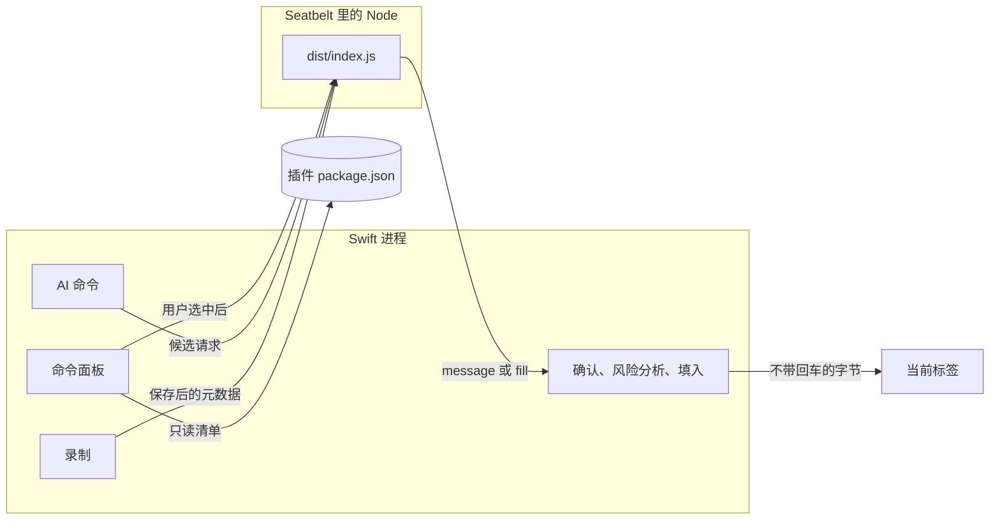

# MuseTerm 插件体系

> 状态：P0 至 P4 的宿主已在 `1.263.0-rc1` 的工作树里，未提交，也还没有在应用界面里装上三个示例插件走一遍。SDK `0.1.0-rc1` 仍未发布。
> 基线：应用 `1.263.0-rc1`（`AppVersion.value`，构建号 388）。
> 语言：插件以 TypeScript 编写、以编译后的 JavaScript 运行。
> 索引：`~/Sites/museterm-plugins-manifest/`，与应用仓库分开。新插件向那个仓库提拉请求。

## 结论

插件是用户装上的不可信代码，跑在应用进程外面。命令面板只读 `package.json` 里的清单，不为了列出一行而执行插件。用户选中、生成命令或录制结束之后，应用才短暂拉起一个被 Seatbelt 限制的 Node 进程，按清单里写明的导出函数调一次。

写伪终端、读钥匙串、弹确认框、Touch ID、120 秒接管租约，都留在 Swift 进程里。插件没有这些入口。它可以让应用把一行命令填进当前标签，不能让应用替它按回车。

公开 SDK 是新包 `@niuwoai/museterm-plugin`，只有类型、清单校验和 JSON Schema。现有的 `@niuwoai/museterm` 仍然只负责下载命令行并讲 MCP，不变成 SDK。

## 从 PI 和 Raycast 拿什么

PI 的扩展跑在编程代理进程里面，用 jiti 直接执行 TypeScript，`export default function (pi)` 之后可以 `registerTool`、`registerCommand`、`registerShortcut`，并用 `pi.on` 接生命周期。`tool_call` 可以拦住一次调用，`before_agent_start` 可以改系统提示词。扩展拥有当前用户的完整操作系统权限。参见 [extensions.md](https://github.com/badlogic/pi-mono/blob/main/packages/coding-agent/docs/extensions.md)。

Raycast 的扩展以 `package.json` 为准。命令、参数、偏好和 AI 工具都先写在清单里，宿主不执行扩展就能建索引。命令分 `view`、`no-view`、`menu-bar`；没有界面的命令是一个短命进程。AI 工具由宿主的模型去调，不是扩展自己订阅终端字节。参见 [Manifest](https://developers.raycast.com/information/manifest) 和 [Lifecycle](https://developers.raycast.com/information/lifecycle)。

| 点 | PI | Raycast | MuseTerm v1 |
| --- | --- | --- | --- |
| 进程 | 进程内 | 每次命令一个进程 | 每次调用一个进程，且必须先过 Seatbelt |
| 发现命令 | 执行代码后注册 | 读清单 | 读清单 |
| TypeScript | jiti 直接跑 `.ts` | 作者先编译 | 作者先编译，宿主只跑 `dist/index.js` |
| 界面 | 自己的 TUI | React | 没有。只往现有命令面板和 AI 浮层加行 |
| 能拦住宿主 | 能，且能改写输入 | 不能 | 不能。宿主的确认框不可被插件取消 |
| 信任 | 等同用户本人 | 商店审核加权限 | 本机显式启用，默认关闭，沙箱先于公开源一键安装 |

不拿过来的部分：jiti、进程内扩展、热重载后重新执行入口、插件改系统提示词、插件持有模型密钥、React 视图、菜单栏模式、打开仓库就执行里面的插件。

## 接到哪里

命令面板在 [CommandPalette.swift](../museterm/CommandPalette.swift)。`CommandPaletteItem.Action` 是封闭枚举：新建标签、命令搜索、任务端口、设置、标签、快捷路径、SSH、录制、已学习命令。搜索是同步的前缀、子串和子序列打分。已学习命令在执行前走 `TerminalCommandRiskAnalyzer`，不是只读就弹现有确认框。插件不往这个枚举里加具体动作，只加一个旁路：`plugin(pluginID, commandID)`。

AI 命令在 [AICommandAssistant.swift](../museterm/AICommandAssistant.swift)。双击 Control 或 Shift 唤起。生成使用固定的本地化系统提示词，上下文是标签、本地还是 SSH、用户、主机、目录、shell、环境。解析只收最多两条单行、不含换行的候选。填入走 `sendToolInput`，只写命令字节，不写回车；选中标签变了就不写。风险画像由应用重算，不信模型自己报的风险。Provider 仍是现有那组：OpenAI、Anthropic、Google、Azure、OpenRouter、SomeIM、Ollama、llama-server、Magpie、自定义。

录制在 [TerminalShortcuts.swift](../museterm/TerminalShortcuts.swift)。记的是 PTY 字节。回显关闭的内容不进 JSON，进受保护库。上限仍是 4000 个事件、64KB、24 条。回放可以要求 Touch ID，也可以关掉 MCP、CLI 和 AppleScript。工具桥的 `save_shortcut` 不能存密码，也不能覆盖已经带受保护输入的录制。

对外自动化已经在进程外：`@niuwoai/museterm` 下载 Ruby 命令行，走 MCP，应用侧用 `Application Support` 下权限 `0700` 的 JSON 文件桥。写入要先配对、再开开关，接管是 120 秒租约。插件不接这条桥，也拿不到配对令牌。

## 不能让插件绕过的事

这几条是对着现有代码核过的，不是假设。

受保护录制不在钥匙串里。`TerminalShortcutProtectedVault` 把密文放在录制目录的 `protected-vault.json`，密钥是同目录的 `protected-vault.key`，都是 `0600`。同一个用户跑起来的 Node 读文件就能解开。所以「协议里不传字节」不够，进程必须读不到这个目录。

钥匙串项没有访问控制列表。`MuseTermKeychain` 的服务名是 `com.museterm.credentials`，AI 密钥在 `im.some.museterm.ai-credentials`，工具桥令牌在 `im.some.museterm.tool-access`。查询只有 class、service、account，可访问性是 `kSecAttrAccessibleAfterFirstUnlock`。同用户进程可以自己调 `SecItemCopyMatching`。插件进程不能拿到钥匙串权限，密钥也不会注入给它。

风险分析把 `echo`、`printf`、`env`、`printenv`、`cat`、`head`、`tail` 算作只读。只读命令在命令面板里不弹确认框。插件若能让应用直接执行这类命令，就可以在没有确认的情况下把密钥文件打到终端上。v1 根本不提供「执行并回车」。填入也比已学习命令更严：只要命令不是空，填入前都走现有确认框，包括分析结果是只读的。未知风险按危险处理。

AI 填入今天不弹这个框，它靠的是不发回车、由人自己按。内置模型这条不改。插件产生的命令不能借这条路：即使用户按的是「填入」，也要先过确认框，再写不带回车的字节。插件不能要求宿主追加回车。

生产环境沿用现有复核，不因为命令来自插件就取消。

## 进程



通信是插件进程标准输入输出上的换行分隔 JSON-RPC 2.0。标准错误只进日志，不当协议。帧上带协议版本。宿主不认的方法直接拒绝。

没有长驻宿主，也不用登录项拉起 Node。命令面板打开、每次按键、空查询，都不生成进程。进程只在三种时候出现：用户执行一条插件命令、一次 AI 生成要问插件要候选、一次录制已经保存完成。超时就杀掉：命令 5 秒，AI 候选 2 秒，录制回调 1 秒。杀掉之后内置功能照常可用。

Node 不从 `PATH` 里找。`PATH` 上的 `node` 可以被换掉。运行时由应用自己管理，版本钉死，放在应用的支持目录里。P1 要求用户在设置里填 Node 22 或更高版本的绝对路径，键是 `plugin.node.path`，不从 `PATH` 搜。公开源一键安装要等应用自带运行时之后。

Seatbelt 配置在第一个插件进程之前就要有，不是后续阶段。v1 的配置拒绝：

- 读录制目录、工具桥目录、钥匙串
- 访问网络
- 写插件自己的目录以外的位置；临时文件只能写宿主给的那个临时目录
- 读用户主目录里除插件目录以外的内容

验收要有一条：插件进程读 `protected-vault.key` 失败，读工具桥目录失败，钥匙串查询失败，对外连接失败。这条没过，P1 不算完成。

## 清单

清单是 `package.json` 的 `museterm` 字段。入口文件不能注册清单里没有的命令。宿主不调清单里没有的导出。

```json
{
  "name": "@example/museterm-deploy",
  "version": "0.1.0",
  "type": "module",
  "museterm": {
    "schemaVersion": 1,
    "engines": { "museterm": ">=1.262.0" },
    "entry": "dist/index.js",
    "displayName": { "en": "Deploy", "zh-Hans": "部署" },
    "permissions": ["palette", "terminal.fill"],
    "commands": [
      {
        "id": "staging",
        "title": { "en": "Deploy staging", "zh-Hans": "部署到预发" },
        "subtitle": { "en": "Fill a deploy command", "zh-Hans": "填入部署命令" },
        "symbol": "shippingbox",
        "priority": 100,
        "export": "deployStaging"
      }
    ]
  }
}
```

`schemaVersion` 不是 1，或者 `engines.museterm` 不覆盖当前应用版本，宿主不加载。

用户能看见的字符串必须同时有 `en` 和 `zh-Hans`。缺当前语言时用 `en`，缺 `en` 则这一条贡献在安装时被拒绝。宿主按应用当前语言取值，不把插件文案写进应用自己的 `Localizable.strings`。

命令完整 id 是 `plugin:<包名>:<command.id>`。包名里的 `/` 换成 `__`，使它能做一个路径分量。与 `app:`、`learned:`、`shortcut:`、`path:`、`ssh:`、`tab:` 撞车的注册直接拒绝。同一个完整 id 安装两次，后一次失败并说明是哪一个包占着，不静默覆盖。

`priority` 限制在 0 到 380。新建标签是 900，置顶的已学习命令是 1000，插件不能排到它们前面。`symbol` 只能是 SF Symbol 名，非法名字回落到 `puzzlepiece.extension`。

每一行都带插件显示名和种类「插件」。插件不能把自己的行装成 SSH、录制或应用动作。

权限是闭集：

| 权限 | 允许 | 不允许 |
| --- | --- | --- |
| `palette` | 在命令面板出现，执行后返回一条消息 | 写终端 |
| `terminal.fill` | 返回一行要填入的命令 | 回车、按键、鼠标、接管租约 |
| `ai.suggest` | 在内置候选之外再给候选 | 改系统提示词、读密钥、替换 Provider |
| `recording.observe` | 录制保存之后收到元数据 | 字节、密码长度、钥匙串账户名、回放、改录制 |

没有 `pty.read`，没有网络权限，没有读屏幕。屏幕快照里有回显开着时输入的秘密，这个权限要等沙箱和单独的授权文案都有了再开。

安装或权限集合变大时，设置页用中文列出每一项权限实际能看到什么。用户确认之前插件保持关闭。权限变小不用再问。

## 三个贡献点

### 命令面板

静态行来自清单，参与现有打分，不启动 Node。用户执行后，宿主调清单里的导出函数：

```ts
export async function deployStaging(
  input: {
    commandID: string
    preferences: Record<string, string | number | boolean>
    tab: {
      id: string
      targetKind: "local" | "ssh"
      environment: string
    }
  }
): Promise<
  | { type: "message"; title: string; body?: string }
  | { type: "fill"; command: string }
>
```

`tab` 只有 id、本地还是 SSH、环境。目录、用户、主机和 shell 不进命令入参。那些字段只给拿了 `ai.suggest` 的生成函数，并且写在授权说明里。

`message` 由应用弹出来，不写终端。`fill` 必须有 `terminal.fill` 权限，否则当成错误。宿主用现有解析器的限制：一行、不含 CR/LF、去空白。然后跑风险分析，弹确认框，确认时选中标签必须仍是调用开始时的那个。通过之后只写命令字节。

按查询动态出行不在 v1。它会让每次按键等 Node。以后若做，也是异步追加、查询一变就丢弃、失败时静态行还在。

### AI 命令

拿了 `ai.suggest` 的插件可以导出：

```ts
export async function suggest(input: {
  request: string
  context: {
    targetKind: "local" | "ssh"
    targetName: string
    user: string | null
    host: string | null
    workingDirectory: string | null
    shell: string | null
    environment: string
  }
}): Promise<{ candidates: { command: string; explanation: string }[] }>
```

宿主不把系统提示词、API 密钥、Provider 配置或屏幕交给插件。上下文里的用户、主机、目录和 shell 会出现在授权说明中。插件自己写的日志宿主控制不了，所以这一权限的文案要写明会看到这些字段。

返回值逐条过现有解析限制：单行、无换行、解释最多 600 字。插件带来的风险标签丢掉，由宿主重算。内置两条候选保留。插件候选另起一区，每个插件最多两条，同时最多四个插件，每条标出来源。不和内置候选抢同一个两条名额。超时或进程失败则只显示内置候选。

填入仍是上面的 `fill` 规则，不走今天内置 AI 那条不确认就写入的路。

### 录制

只有保存完成之后的一个事件：

```ts
export async function onRecording(event: {
  type: "capture.finished"
  shortcut: {
    id: string
    title: string
    eventCount: number
    durationMilliseconds: number
    hasProtectedInput: boolean
    requiresUserAuthentication: boolean
    allowsAutomationPlayback: boolean
  }
}): Promise<void>
```

没有字节，没有文本，没有每步的长度，没有 `protectedBytesReference`。返回值忽略。插件不能开始、停止、保存、替换或回放，不能把 `allowsAutomationPlayback` 从关改成开，也不能取消 Touch ID。标题不接受插件的修改，避免把命令藏进会出现在面板里的标题。

## 偏好

v1 只有 `text`、`boolean`、`dropdown`。值由应用存，按插件隔离，卸载时一起删。不做密码型偏好：现有钥匙串没有访问控制列表，注入到插件进程里也等于把秘密交给不可信代码。密码型要等独立的钥匙串服务名、只有应用能读的访问控制，以及卸载时按 `plugin/<id>/<name>` 删除。

## SDK

`@niuwoai/museterm-plugin` 的 `0.1.0-rc1` 已放在 `npm/museterm-plugin`，尚未发布。`publishConfig.access` 为 `public`，发布标签是 `rc`。它导出：

- 上面这些入参、返回值和清单的 TypeScript 类型
- `definePlugin(manifest)`，只做类型检查，不连应用
- `checkPluginPackage(packageJson, { appVersion })`，校验完整的 `package.json`
- 与应用将来读到的同一份 JSON Schema，路径是 `schema/manifest.schema.json`，方言是 draft 2020-12，校验使用 ajv 的 `Ajv2020`

不含二进制，不下载命令行，不包装 MCP，不读工具桥目录。作者用自己的 `tsc` 产出 `dist/index.js`。宿主不跑 TypeScript，也不嵌 jiti。

P0 的校验已经能拒绝：缺字段、缺 `en` 或 `zh-Hans`、四项之外的权限、不是 1 的 `schemaVersion`、空命令、优先级超过 380、重复的命令和偏好、下拉框默认值不在选项里、`preinstall` / `install` / `postinstall` / `prepare`，以及 `file:`、`link:` 和 git 依赖。版本范围只接受精确版本、`*` 和 `>=`；`>=1.262.0` 不覆盖 `1.262.0-rc2`，因为正式版比同号 rc 新。

示例插件不进应用仓库。索引仓库是 `~/Sites/museterm-plugins-manifest/`：根目录 `index.json` 列出 `name`、`version`、`description`，源码在 `plugins/<包名>/`。三个包各自初始化，`engines.museterm` 都是 `>=1.263.0-rc1`：

| 包 | 权限 | 做什么 |
| --- | --- | --- |
| `@example/museterm-repo-daily` | `palette`、`terminal.fill` | 填入 `git status --short`、`git log -5 --oneline`、`git branch --show-current` |
| `@example/museterm-troubleshoot` | `palette`、`ai.suggest` | 按请求文本匹配本地排查短语，不读目录，不联网；命令面板只报短语数量 |
| `@example/museterm-recording-ledger` | `palette`、`recording.observe` | 录制保存后把白名单字段写进自己的临时目录，命令面板显示最近一条 |

`ai.suggest` 不能单独出现：清单有命令就必须有 `palette`。排查插件的命令只返回 `message`，候选仍然只来自 `ai.suggest`。

## 安装

目录是应用支持目录下新的 `Plugins/<id>/`，权限 `0700`，与工具桥目录、录制目录分开。一个包一个目录。

安装命令固定带 `--omit=dev --ignore-scripts`。宿主拒绝自身或依赖带有 `preinstall`、`install`、`postinstall`、`prepare` 的包，也拒绝 `git:` 和 `file:` 依赖。现有 CLI 包的 `postinstall` 会下载二进制，插件不能继承这个行为。

只有用户级。不读仓库里的 `.museterm/`。打开一个项目不得执行别人提交的代码。本地文件夹可以装，界面上标成未签名的本地代码。

没有商店，没有自动更新，没有目录监视。改了文件要用户在设置里重新加载。重新加载只重读清单；权限变大则再次确认。热重载会让未确认的修改直接生效，所以不做。

单个插件崩溃只禁用它自己，命令面板仍显示它的静态行，执行时显示错误。宿主日志只记插件 id、导出名、耗时和错误类别，不记命令文本、上下文和标准错误里的负载。

## 分期

每一期都能单独交付。前一期没有完成标准，不开后一期。

**P0，只有类型。已完成，尚未发布。** SDK 和 JSON Schema 在 `npm/museterm-plugin`，版本 `0.1.0-rc1`。完成标准：示例清单能被校验拒绝掉缺字段、缺中文、非法权限和错误的 `schemaVersion`。`npm test` 已覆盖这四项。

**P1，静态命令。宿主已写入，测试通过。** 设置里按索引里的包名或本地目录安装，默认关闭。命令面板显示静态行。执行可以返回 `message`。安装器拒绝生命周期脚本和 `file:`、`link:`、git 依赖。Seatbelt 验收已通过：插件自己的文件可读，家目录下的保险箱文件、工具桥目录和同级文件不可读，钥匙串查询失败，对外连接失败。

**P2，填入。宿主已写入。** `terminal.fill` 权限。每次非空填入都先确认，包括 `echo` 这类只读命令。确认时选中标签必须没变，写入不带回车。正式环境或危险命令会再确认一次。应用界面里用 `echo`、`cat` 和一条危险命令各走一遍还没做。

**P3，AI 候选。宿主已写入。** 插件候选独立成区并标来源。每个插件最多两条，同时最多四个插件。插件超时时内置两条仍然出现。插件候选的填入走 P2 的确认，不走内置 AI 的直接写入。

**P4，录制观察。宿主已写入。** 只在保存完成之后发元数据。请求只带白名单字段：`id`、`title`、`eventCount`、`durationMilliseconds`、`hasProtectedInput`、`requiresUserAuthentication`、`allowsAutomationPlayback`。测试确认载荷没有 `events` 和 `protectedBytesReference`。回放、Touch ID 和自动化开关的既有测试这次没有重跑。

以后才考虑：按查询动态出行、读屏幕、网络、密码偏好、带哈希确认的项目级插件、插件视图、商店。插件不注册 MCP 工具。外部代理仍走现有工具桥；以后若要让宿主模型调用插件命令，也是宿主去调，不把工具桥令牌交给插件。

## 不做

- 不把 Node 放进 SwiftUI 进程。
- 不用插件钩子取代风险确认、Touch ID 或接管租约。
- 不让插件写回车、发按键、发鼠标、建隧道、打开 SSH、回放录制。
- 不让插件换 Provider 或读应用里的模型密钥。
- 不在 v1 做商店、热重载和仓库级自动加载。
